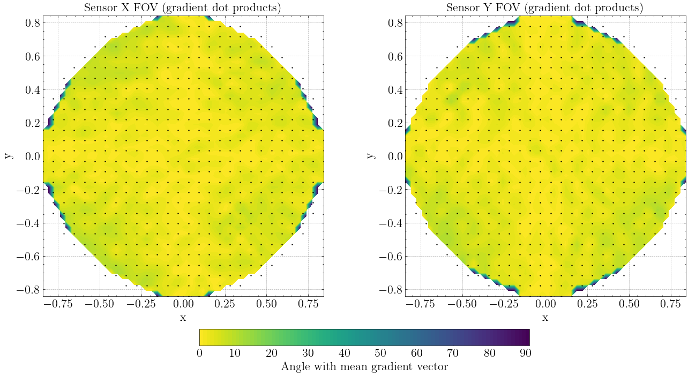
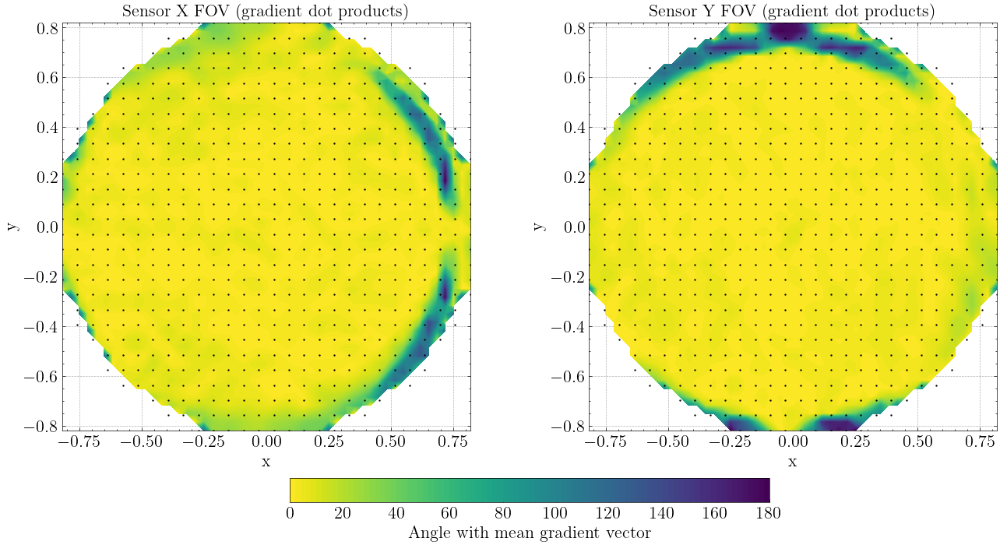
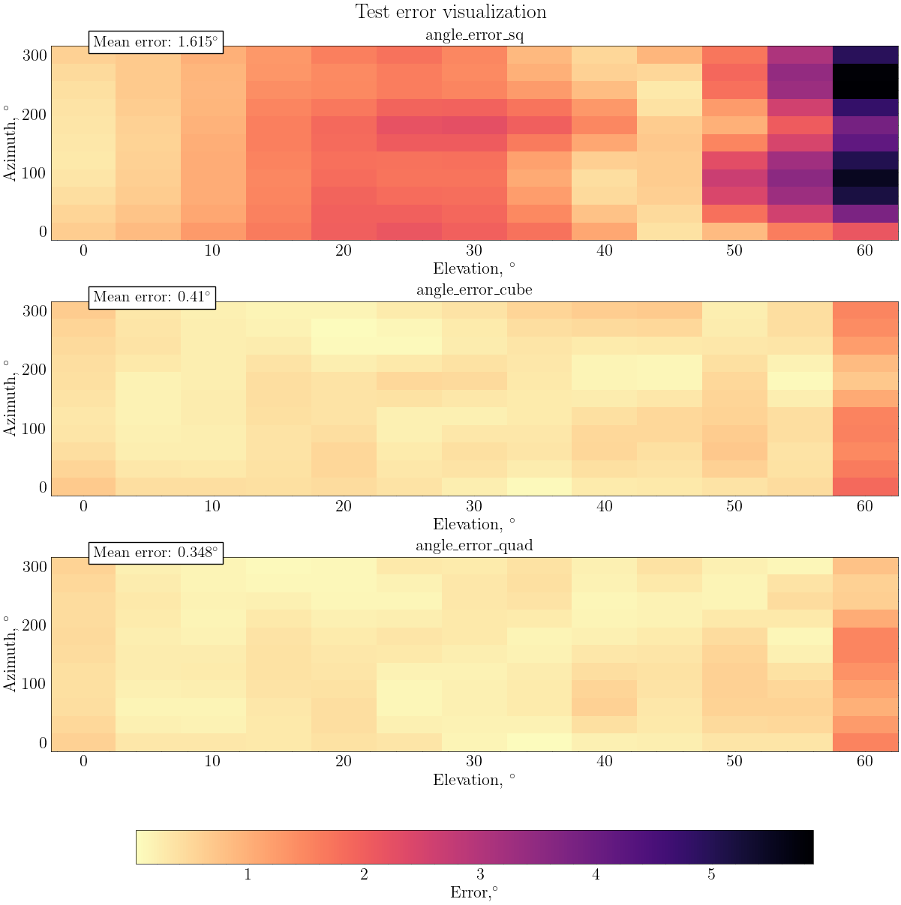

# QD Sun Sensor Calibration

Estimating the Sun direction for small spacecraft using a four-quadrant photodiode sensor. The project explores how accurately a compact sensor can recover a 3D direction, how to determine its usable field of view, and how much computation each calibration model requires.

**Five calibration methods · Sub-degree mean error · Laboratory measurements from 30+ sensors**

## From photodiode readings to a direction vector

Four intensity readings are converted into normalized light-spot coordinates $(x,y)$. Calibration learns a mapping from these coordinates to the Sun direction in the solar panel's coordinate system:

$$
(I_1,I_2,I_3,I_4) \longrightarrow (x,y) \xrightarrow{\text{calibration}} (X,Y),
\qquad Z=\sqrt{1-X^2-Y^2}.
$$

Using a unit vector reduces the learning problem to two outputs. Each sensor receives its own calibration, derived from measurements on a two-axis rotary platform. The target is a **mean angular error below 1°** within the usable field of view.

The reconstructed **3D Sun direction vector** serves as a measurement input to an **Extended Kalman Filter (EKF)** in the attitude determination system onboard a real CubeSat, contributing to the spacecraft's orientation estimate.

*Measured calibration surfaces for one sensor: $X(x,y)$ and $Y(x,y)$.*

## Finding the usable field of view

Near the edge of the sensor's view, the measurement response can turn back on itself, making inversion ambiguous. Field-of-view estimation combines radial response analysis with the directions of local gradients. Large deviations from the mean gradient reveal problematic regions and manufacturing defects.

| Sensor with a broad usable field of view | Sensor affected by a manufacturing defect |
| --- | --- |
|  |  |

*Yellow indicates consistent gradient directions; darker regions show increasing deviation. Each image contains the two sensor-coordinate responses.*

## Calibration methods and accuracy

The study develops a linear model, adapts geometric and polynomial models to the vector representation, and evaluates two machine learning approaches. Error is the angle between the reference and predicted unit vectors.

| Method | Model | Mean error | Mean standard deviation |
| --- | --- | ---: | ---: |
| Linear | Affine transformation fitted by least squares | 1.586° | 1.209° |
| Geometric | Sensor geometry with positional offsets | 1.335° | 0.822° |
| Cubic polynomial | Two multivariable polynomial regressions | **0.329°** | **0.227°** |
| Gradient boosting | XGBoost regressors | 1.195° | 0.880° |
| Neural network | MLP with input standardization | 0.464° | 0.408° |

*Reported aggregate results across sensors. Standard deviations are computed per sensor and then averaged.*

| Linear approximation | Cubic polynomial approximation |
| --- | --- |
|  |  |

*Rotating views of fitted surfaces for the same sensor. Color represents angular error; each animation has its own scale.*

Polynomial degrees 2–4 were investigated. Moving from quadratic to cubic substantially reduces error, while a fourth-degree model provides a smaller improvement at greater computational cost. The spatial error maps below show how this varies across viewing directions.

*One sensor, polynomial degrees 2, 3, and 4 from top to bottom. Error tends to increase near the field-of-view boundary.*

## Accuracy versus computation

C++ benchmarks compare the cost of recovering a direction from calibrated models using synthetic inputs.

| Model | Mean execution time |
| --- | ---: |
| Linear | **187 ns** |
| Quadratic polynomial | 281 ns |
| Cubic polynomial | 480 ns |
| Geometric, positional offsets | 543 ns |
| Fourth-degree polynomial | 726 ns |
| Geometric, positional and angular offsets | 1,034 ns |

*Host benchmark measurements; timings depend on the execution platform.*

The cubic model offers a practical balance: **0.329° mean error** at roughly **2.6× the execution time** of the linear model. The MLP also reaches sub-degree mean error, while the linear model offers the lowest inference cost.

The calibration results were integrated into Geoscan's small spacecraft attitude control system. The implementation includes Python experiments, calibration grid generation, automated sensor reports, and C++ inference benchmarks.

Further details: [full study](Documents/Thesis_Kiz_N_A_RUS.pdf) (Russian) · [article](Documents/ICINS_Kiz_N_A_ENG.pdf) (English) · [experiment notebook](Sources/UtilNotebook.ipynb).
